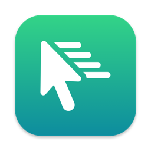
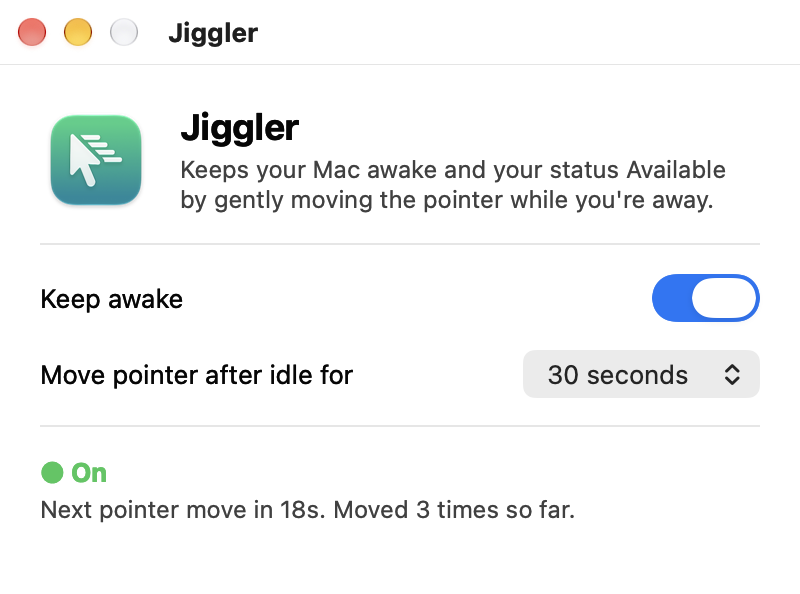
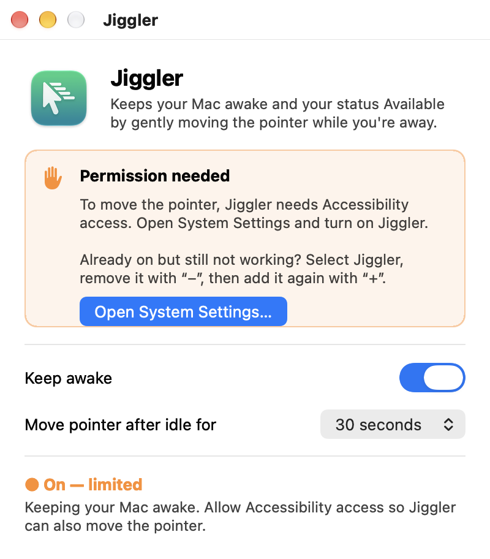

<div align="center">



# Jiggler

**Keep your Mac awake and your Teams status Available.**

A tiny native macOS app that gently moves the pointer while you're away, and only while it's open.


[](LICENSE.md)

<picture>
  <source media="(prefers-color-scheme: dark)" srcset="docs/screenshot-dark.png">
  
</picture>

</div>

## Features

- **One switch.** Turn *Keep awake* on or off at any time. Off means fully off.
- **Runs only while open.** Close the window or press <kbd>⌘</kbd><kbd>Q</kbd> and everything stops. Nothing runs in the background or at login.
- **Stays out of your way.** The pointer only moves after you've been idle for the time you choose (15 seconds to 4 minutes). If you touch the mouse mid-move, it stops and leaves the pointer where you put it.
- **Prevents sleep.** It tells macOS not to idle-sleep while on. This works even before you grant permission.
- **Guided permission setup.** It walks you through granting Accessibility access and notices when you have, with no restart needed.
- **Native and lightweight.** Written in Rust on AppKit, with no runtime dependencies. Supports light and dark mode and remembers your settings.

## Install

Jiggler is built from source. You need:

- macOS 11 Big Sur or later
- [Rust](https://rustup.rs) 1.87 or newer
- Xcode Command Line Tools: `xcode-select --install`

```sh
git clone https://github.com/adilkhali/jiggler.git
cd jiggler
scripts/bundle.sh --install
```

This builds `dist/Jiggler.app` and copies it to `/Applications`. Leave off `--install` to only build it. Then open **Jiggler** from Applications or Spotlight.

> [!NOTE]
> The app is built for your Mac's own architecture (Apple Silicon or Intel).

## Granting permission

macOS only lets apps move the pointer with **Accessibility** access.

1. On first launch, macOS asks whether Jiggler may control your computer. Click **Open System Settings**.
2. Turn on **Jiggler** under **Privacy & Security → Accessibility**.
3. Switch back to Jiggler. The status turns green within a second.

If you dismiss the prompt, the window shows a reminder with an **Open System Settings…** button:

<div align="center">
<picture>
  <source media="(prefers-color-scheme: dark)" srcset="docs/permission-dark.png">
  
</picture>
</div>

## How it works

| | |
| --- | --- |
| **Staying awake** | While on, Jiggler holds a `PreventUserIdleDisplaySleep` power assertion, the same mechanism `caffeinate -d` uses. |
| **Staying Available** | Teams, Slack and similar apps decide you're away from the system idle timer. Once you've been idle for the chosen time, Jiggler posts a few small circular mouse movements as system input events. That resets the idle timer, then the pointer goes back to where it was. |
| **Respecting you** | It checks the idle timer every second and never moves the pointer while you're using the Mac. |

You can see the sleep assertion while Jiggler is on:

```sh
pmset -g assertions | grep Jiggler
```

## Troubleshooting

<details>
<summary><b>Jiggler is enabled in System Settings but still says "Permission needed"</b></summary>

Builds without a Developer ID certificate are signed *ad-hoc*, so macOS treats every rebuild as a new app. Select Jiggler in **Accessibility**, remove it with **–**, then add `/Applications/Jiggler.app` again with **+**. Or reset it from Terminal and relaunch:

```sh
tccutil reset Accessibility com.jiggler.app
```

To avoid this, sign with a stable identity (see [Development](#development)).
</details>

<details>
<summary><b>My MacBook still sleeps when I close the lid</b></summary>

That's expected. Closing the lid always sleeps a MacBook unless it's connected to power and an external display. Jiggler only prevents *idle* sleep.
</details>

<details>
<summary><b>My status still goes Away</b></summary>

Make sure the status line says **On** in green, not **On, limited**, and that the idle time is shorter than your chat app's away timeout (Teams uses 5 minutes). Some apps also go Away when your calendar or a manual status says so. Jiggler can't change that.
</details>

## Uninstall

Quit Jiggler, then:

```sh
rm -rf /Applications/Jiggler.app
defaults delete com.jiggler.app            # saved settings
tccutil reset Accessibility com.jiggler.app  # permission entry
```

## Development

```sh
cargo run                    # run unbundled (permission is then tied to your terminal)
cargo clippy && cargo fmt    # lint and format
scripts/bundle.sh            # build and sign dist/Jiggler.app
```

Optional `scripts/bundle.sh` settings:

| Variable | Default | Purpose |
| --- | --- | --- |
| `SIGN_IDENTITY` | `-` (ad-hoc) | Code-signing identity, e.g. `"Developer ID Application: Name (TEAMID)"`. A stable identity keeps the Accessibility permission across rebuilds. |
| `BUNDLE_ID` | `com.jiggler.app` | Bundle identifier. |
| `BUILD_NUMBER` | `1` | Build number shown in About (`CFBundleVersion`). The version itself comes from `Cargo.toml`. |

| Path | Purpose |
| --- | --- |
| [`src/main.rs`](src/main.rs) | App delegate, window, menu, timer and state |
| [`src/system.rs`](src/system.rs) | macOS APIs: pointer events, idle time, Accessibility, power assertion |
| [`assets/`](assets) | `Info.plist` template and app icon |
| [`scripts/bundle.sh`](scripts/bundle.sh) | Builds, bundles and signs `Jiggler.app` |
| [`scripts/make_icon.swift`](scripts/make_icon.swift) | Regenerates `assets/AppIcon.icns` (delete the `.icns` and rebuild) |

## Disclaimer

Jiggler is a convenience tool for your own Mac. Check your employer's policies before using it on a work device. The software is provided as-is, without warranty.

## License

Copyright © 2026. Released under the [PolyForm Noncommercial License 1.0.0](LICENSE.md). You're free to use, modify and share it for **noncommercial** purposes. Commercial use is not permitted.
